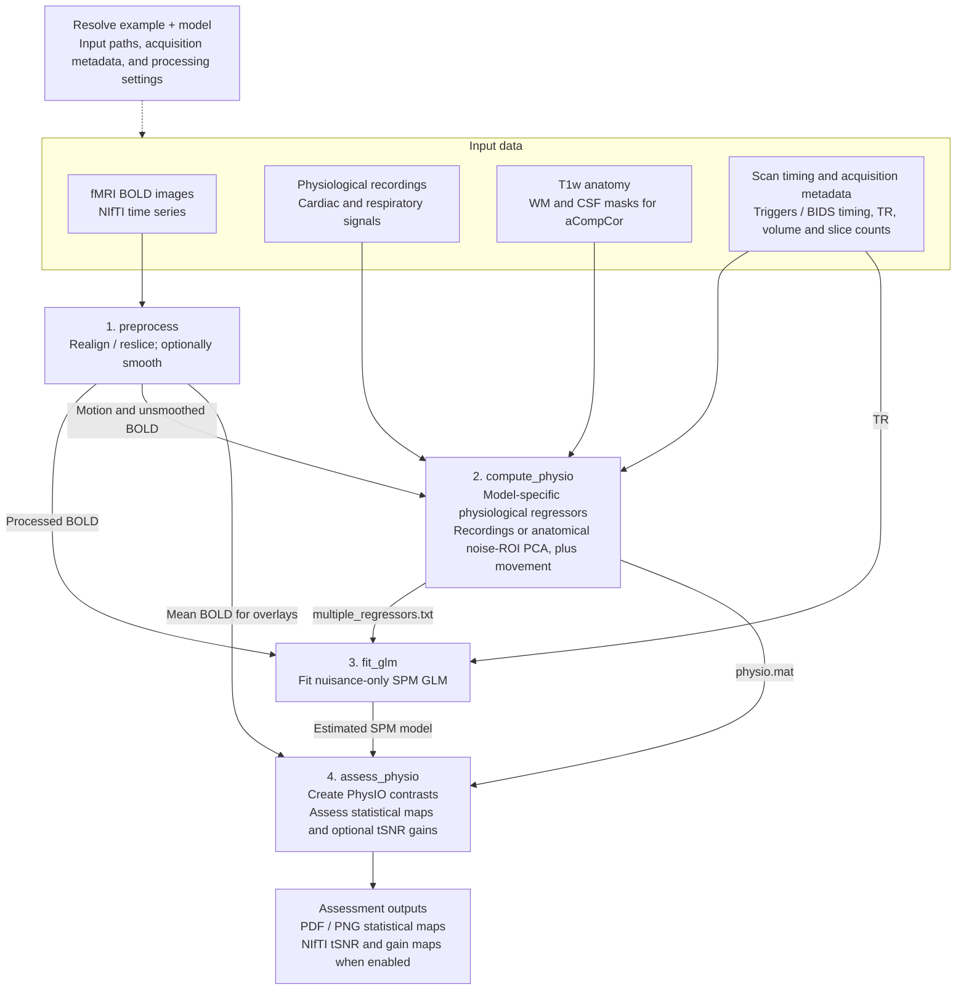

[](https://matlab.mathworks.com/open/github/v1?repo=likeajumprope/physio-4-all)

# PhysIO-4-All

Repository demonstrating the application of the PhysIO toolbox to a wide range of public fMRI datasets, with an emphasis on OpenNeuro.

See [From BrainHack Prototype to PhysIO-4-All](DESIGN_EVOLUTION.md) for a short
account of how the original BrainHack workflow was generalized into this
repository.

## Dependencies

This repository depends on upstream copies of:

- [SPM](https://github.com/spm/spm)
- [PhysIO](https://github.com/ComputationalPsychiatry/PhysIO)

Both dependencies are included as pinned Git submodules under `external/`:

```text
external/
  spm/
  PhysIO/
```

Note: `physio4all_setup.m` adds the pinned SPM and PhysIO copies under `external/` to the MATLAB path and puts PhysIO as a link/copy to `external/spm/toolbox/PhysIO` to work with the SPM Batch Editor.

## Installation

### Simple Installation

Clone the repository and run the setup script:

```bash
git clone https://github.com/likeajumprope/PhysIO-4-All.git
cd PhysIO-4-All
```

Then start MATLAB in the repository root and run:

```matlab
physio4all_setup
```

This does

1. Download/Initialize the SPM and PhysIO dependencies (Git submodules) to `external/`.
2. Link `PhysIO` to `external/spm/toolbox/PhysIO` for usage of PhysIO in the SPM Batch Editor.
3. Adds the right folders to the Matlab path.

## Example Data

Example datasets use a stable canonical ID of the form
`<source>_<accession>_<mnemonic>`. Public callers also accept the shorter
mnemonic. The currently registered examples are:

| Mnemonic | Canonical ID | Data location |
|---|---|---|
| `brainhack23` | `openneuro_ds004808_brainhack23` | `data/openneuro/ds004808` |
| `fastfmri` | `openneuro_ds004645_fastfmri` | `data/openneuro/ds004645` |

Run `physio4all_download_example_data("info")` to list registry metadata.

To download the first example dataset used in `mrikasper/brainhack-physio`, run:

```matlab
physio4all_download_example_data("brainhack23")
```

This defaults to `sub-46` and creates a reproducible subset under
`data/openneuro/ds004808`.

To request specific subjects, pass a numeric subject ID or vector as the second input:

```matlab
physio4all_download_example_data("brainhack23", 44)
physio4all_download_example_data("brainhack23", [44 46])
```

If a requested subject has no upstream OSF physio logs, the downloader warns and still downloads the imaging files from OpenNeuro.

The second example downloads 7T resting-state fMRI and BIDS physiology from
the pinned OpenNeuro `ds004645` version 1.0.0 snapshot:

```matlab
physio4all_download_example_data("fastfmri")
physio4all_download_example_data("fastfmri", [1 2])
```

This defaults to `sub-01`, accepts subject numbers 1 through 15, and stores
the subset under `data/openneuro/ds004645`. NIfTI images are decompressed for
SPM; the BIDS physiology files remain compressed.

## Run an Example

```matlab
physio4all_setup
results = physio4all_run("brainhack23", ...
    Subject="sub-46", Run=1, Model="model-001");
```

For the ds004645 resting-state example:

```matlab
results = physio4all_run("fastfmri", ...
    Subject="sub-01", Run=1, Model="model-001");
```

The model family keeps motion regression, 3 mm GLM smoothing, and SPM GLM
settings consistent while varying the physiological regressors:

| Model | Physiological regressors |
| --- | --- |
| `model-001` | RETROICOR + HRV + RVT (existing default) |
| `model-002` | aCompCor: four PCs + mean from each of WM and CSF |
| `model-003` | aCompCor: PCs exceeding 50% variance + mean from each tissue |
| `model-004` | RETROICOR |
| `model-005` | RETROICOR + RVT |
| `model-006` | RETROICOR + HRV |

All models retain six motion regressors. Motion censoring is off by default;
set `model.physio.movementCensoringEnabled = true` in a configuration to enable
its configured outlier-regressor method and threshold. Existing outputs must
be recomputed to reflect a changed censoring setting.

For example, select `Model="model-002"` or `Model="model-003"` in the call
above. Both aCompCor variants run entirely in PhysIO and use unsmoothed,
realigned BOLD for PCA. They require one uncompressed `*_T1w.nii` in the
subject's `anat/` directory; physiological recordings are not required.
SPM segments the T1w and aligns eroded WM/CSF masks to the BOLD grid.
Review those masks before interpreting results, especially for partial
brain coverage. See [model settings and references](models/README.md) for
the CONN/fMRIPrep connections and the differences from those pipelines.

New models store regressors under `physio/<model>/`; model-001 retains its
existing `physio/` location. GLMs, assessments, and logs are model-specific.

For a fresh run that keeps disposable preprocessing files on a local scratch
disk while retaining durable outputs under the repository's `derivatives/`
folder, use:

```matlab
physio4all_setup
results = physio4all_run("brainhack23", ...
    Subject="sub-46", ...
    Run=1, ...
    Model="model-001", ...
    WorkRoot="C:\Users\kasperla\TEMP\physio4all\work", ...
    Overwrite=true, ...
    EnableDiary=true, ...
    ComputeTsnrGains=true, ...
    Verbose=true);
```

`WorkRoot` can point to any writable scratch location. `Overwrite=true`
recomputes the requested stages instead of reusing their checkpoints. The
remaining options above are the defaults and are shown explicitly to make the
run configuration clear. Unless `Stages` is specified, the pipeline runs
preprocessing, PhysIO computation, GLM estimation, and assessment.

Pipeline output is also appended incrementally to a predictable diary:

```text
derivatives/<example>/<subject>/<run>/logs/<model>/
    <subject>_<run>_<model>_pipeline.log
```

Follow a running pipeline from PowerShell with:

```powershell
Get-Content .\derivatives\<example>\<subject>\<run>\logs\<model>\*.log -Wait
```

Set `EnableDiary=false` to disable logging, or pass `LogFile="path/to/log"`
to choose a different location.

## Pipeline Description (`physio4all_run`)



Solid arrows show data flow; the dotted arrow shows input resolution. The
selected example and model configure all four numbered stages.

`physio4all_run` loads the dataset definition from `examples/`, applies the
selected `model-###` from `models/`, resolves the input files and output roots,
starts the diary, and coordinates four stages:

| Stage | Main function | Broad purpose | Durable output |
|---|---|---|---|
| `preprocess` | `physio4all.preprocess` | Copy the BOLD image into disposable work storage, realign/reslice it, and optionally smooth it. | Realigned/smoothed BOLD images, mean image, motion parameters, and checkpoint. |
| `compute_physio` | `physio4all.compute_physio` | Read the physiological logs and create the configured PhysIO nuisance regressors. | `physio.mat`, `multiple_regressors.txt`, BIDS physiology files, and PhysIO figures. |
| `fit_glm` | `physio4all.fit_glm` | Specify and estimate a nuisance-only SPM first-level model using the processed BOLD data and PhysIO regressors. | `SPM.mat`, beta images, residual variance, mask, and contrast images. |
| `assess_physio` | `physio4all.assess_physio` | Create PhysIO contrasts and export visual statistical-map and tSNR comparisons. | PDF/PNG statistical maps, NIfTI tSNR maps, and assessment checkpoints. |

The default `Stages` value runs all four stages. A request for a later stage
also resolves its upstream products. With `Overwrite=false`, complete upstream
outputs are reused; with `Overwrite=true`, the selected stage and its required
upstream chain are rebuilt. The returned `results` struct records the resolved
configuration, roots, and outputs from every stage that ran or was reused.

Checkpoints act as completion markers along this sequence: they are written
only after the output set they describe has been produced successfully. On a
later invocation with `Overwrite=false`, the pipeline uses these markers
together with the required stage outputs to reuse completed work and continue
with the next requested step. A missing checkpoint or required output prevents
a partially completed step from being treated as resumable. These readable
JSON markers live beside the durable stage outputs below
`derivatives/<example>/<subject>/run-<NN>/` and use the
`*_checkpoint.json` filename pattern. Checkpoints for model-specific outputs
are nested one level further below `model-<NNN>`.

The pipeline keeps downloaded data unchanged:

```text
data/          downloaded inputs
work/          disposable preprocessing files
derivatives/   PhysIO, GLM, statistical maps, and assessment reports
```

Reusable implementation functions live in the `physio4all` namespace under
`src/+physio4all`. The setup function adds `src`, which is the namespace
parent, and does not add the `+physio4all` folder itself.

## Repository Structure

The `examples/` folder contains **code and documentation describing each
example**, not the downloaded example data. An example definition specifies
how to find the dataset files, which acquisition metadata and PhysIO settings
to use, and which pipeline options are appropriate for that dataset.

```text
PhysIO-4-All/
|-- examples/                       Dataset-specific configurations and documentation
|   |-- openneuro_ds004808_brainhack23/
|   |   |-- physio4all_example_openneuro_ds004808_brainhack23.m
|   |   `-- README.md
|   `-- openneuro_ds004645_fastfmri/
|       |-- physio4all_example_openneuro_ds004645_fastfmri.m
|       `-- README.md
|-- models/                         Reusable analysis configurations
|   |-- physio4all_model_001.m
|   `-- README.md                   Model catalog and pipeline summaries
|-- src/
|   `-- +physio4all/                Reusable pipeline namespace
|-- tests/                          MATLAB unit tests
|-- data/                           Downloaded input datasets (Git-ignored)
|-- work/                           Disposable processing copies/intermediates (Git-ignored)
|-- derivatives/                    Durable pipeline outputs (Git-ignored)
|-- DESIGN_EVOLUTION.md             Origin and refactoring rationale
|-- physio4all_run.m                Public pipeline entry point
|-- physio4all_setup.m              Path and dependency setup
`-- physio4all_download_example_data.m
```

This separation keeps dataset-specific decisions small and reviewable while
sharing the preprocessing, PhysIO computation, GLM, and assessment
implementation across all examples. Downloaded inputs remain unchanged under
`data/`; SPM can modify copies under `work/`; and outputs intended for review
or reuse are written under `derivatives/`.

### Derivative output layout

Outputs are organized first by dataset example, then subject and run. The GLM,
assessment, and diary paths include the model ID so alternative model
configurations remain distinguishable.

```text
derivatives/
`-- <example-id>/
    `-- <subject-id>/
        `-- run-<NN>/
            |-- preproc/
            |   |-- r<bold>.nii                 Realigned BOLD image
            |   |-- sr<bold>.nii                Smoothed BOLD image, when enabled
            |   |-- mean<bold>.nii              Mean realigned image
            |   |-- rp_<bold>.txt               Motion parameters
            |   `-- preprocessing_checkpoint.json Human-readable resume checkpoint
            |-- physio/
            |   |-- physio.mat                  Complete PhysIO result structure
            |   |-- multiple_regressors.txt     Regressors used by the GLM
            |   |-- *_desc-preproc_physio.*     BIDS physiology export
            |   `-- physio_*.fig                PhysIO diagnostic figures
            |-- glm/
            |   `-- model-<NNN>/
            |       |-- SPM.mat
            |       |-- beta_*.nii
            |       |-- ResMS.nii
            |       `-- spmF_*.nii / ess_*.nii
            |-- assessment/
            |   `-- model-<NNN>/
            |       |-- statistical_maps/       PDF and PNG overlays
            |       |-- tsnr_maps/              Raw, model, and ratio NIfTI maps
            |       `-- *_checkpoint.json       Human-readable resume checkpoints
            `-- logs/
                `-- model-<NNN>/
                    `-- *_pipeline.log           Incremental MATLAB diary
```

`preproc/` and `physio/` are currently run-level products. Model-specific GLM,
assessment, and log products live below `model-<NNN>` directories. Use
`Overwrite=true` when deliberately recomputing run-level products after their
configuration changes.

Each dataset example selects a default configuration from the top-level
`models/` folder, such as `model-001`. The model catalog summarizes each
pipeline, while its MATLAB configuration records preprocessing,
PhysIO-regressor, GLM, and assessment parameters. GLM outputs, statistical
maps, tSNR maps, and their checkpoint files are stored below folders named
with that model ID.
Changing analysis parameters therefore means adding a new configuration
(for example, `model-002`) rather than encoding every parameter in filenames
or overwriting results from another model.


### Manual Installation

If you prefer to initialize dependencies yourself, clone the repository together with its submodules:

```bash
git clone --recurse-submodules https://github.com/likeajumprope/PhysIO-4-All.git
cd PhysIO-4-All
```

If you already cloned the repository without submodules, fetch them with:

```bash
git submodule update --init --recursive
```

Then start MATLAB in the repository root and run:

```matlab
physio4all_setup
```

The setup script adds the required SPM and PhysIO folders to the MATLAB path and validates that both submodules are present and in the right location.

## Notes

- GitHub ZIP downloads do not include submodule contents.
- Please use `git clone --recurse-submodules` for a complete installation.
- Dependency versions are pinned by submodule commit for reproducibility.
